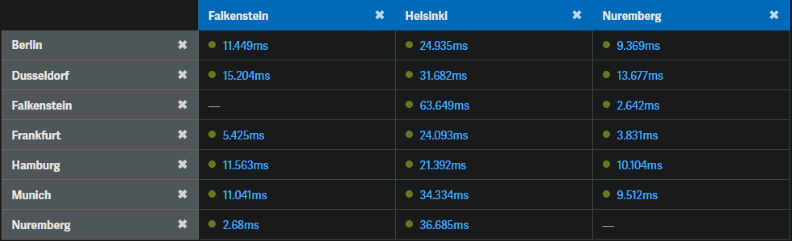
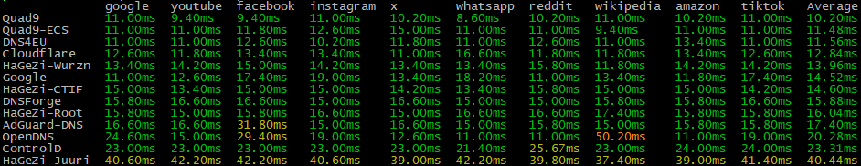

# HaGeZi DNS: Free, Non-Commercial EU Public DNS Servers

HaGeZi DNS is a handful of free public DNS resolvers in the EU. No company behind it, no ads, no account. It's run by a private person, mainly for people in Europe. They block ads, trackers, scams, phishing, fake shops, and malware before your device even connects.

> [!NOTE]
> This page is about setup and how things work. The privacy policy, the EU Digital Services Act (DSA) stuff, and the legal glossary live in [PRIVACY](PRIVACY.md).

## Table of contents

- [Cheat sheet (quick start)](CHEATSHEET.md)
  - [Pick a server by country and protection level](CHEATSHEET.md#pick-server)
  - [Connect (recommended: encrypted)](CHEATSHEET.md#connect)
  - [Platform setup (Apple, Android, Windows, router)](CHEATSHEET.md#platform-setup)
  - [Unencrypted fallback (Do53)](CHEATSHEET.md#do53-fallback)
  - [Verify it's working](CHEATSHEET.md#verify)
  - [Something not working?](CHEATSHEET.md#troubleshooting)
  - [Good to know](CHEATSHEET.md#things-to-know)
- [Features](#features)
  - [Security and privacy](#security-privacy)
  - [Filtering and blocking](#filtering)
    - [Block TTL and response](#block-ttl)
    - [Special domain handling](#special-domains)
- [Logging and data handling](#logging)
  - [Server health and hourly statistics](#server-health)
- [Server locations and access](#server-locations)
  - [Full protection servers](#full-servers)
  - [Threat-only server](#threat-servers)
  - [DNS stamps](#dns-stamps)
    - [Full protection servers](#dns-stamps-full)
    - [Threat-only server](#dns-stamps-threat)
  - [Latency](#latency)
  - [Expected IP addresses](#ip-addresses)
- [Test scripts](#test-scripts)
- [Web-based DNS testing services](#testing-services)
- [FAQ](#faq)
  - [Does HaGeZi DNS support ECH?](#faq-ech)
- [Getting help](#help)
- [Glossary](#glossary)
- [Legal and privacy](#legal-privacy)

## Features <a id="features"></a>

- Everything runs in the EU, at Hetzner in Falkenstein, Nuremberg, and Helsinki, under EU law. The setup follows the GDPR and the [ENISA](PRIVACY.md#glossary) recommendations.
- It's open source all the way down: Technitium DNS Server faces the internet, and Unbound does the actual resolving behind it, with its own local copy of the root zone.

### Security and privacy <a id="security-privacy"></a>

- Your queries never get passed on to Google, Cloudflare, or any other resolver. The servers look everything up themselves.
- Strict DNSSEC validation.
- QNAME minimization.
- Protection against DNS leaks and DNS rebinding.
- No EDNS Client Subnet, so upstream servers never learn where you are.
- ANY queries get dropped. That's better for performance and privacy.
- Strict rate limits per client and for responses.
- Encrypted DNS: DNS-over-HTTPS/3 (DoH/DoH3), DNS-over-TLS (DoT), and DNS-over-QUIC (DoQ).
- HTTPS records come through untouched, ECH keys included, so your browser can use ECH with websites that support it. The endpoints themselves don't use ECH, see the [FAQ](#faq-ech).
- EDE (Extended DNS Errors), so errors come with an actual reason.
- CHAOS queries for `version.bind` and `id.server` are refused. Nobody needs to know which software or instance is answering.
- The firewall only opens the ports the service really needs.
- Well-known internet scanners are blocked at the firewall.
- Known bad or abusive IPs are blocked at the firewall too. For that, the servers keep local copies of threat-intelligence lists (e.g., Spamhaus, AbuseIPDB) and check against them on the server itself. Your IP is never sent to those providers.
- IPs that attack the service directly (e.g., flooding Do53) get blocked as well, whether or not they're on any list.
- Tor exit nodes are blocked completely, because a constant stream of attacks comes from that network. DNS queries over Tor won't get an answer.
- The OS and the DNS software get updated regularly.
- Individual queries aren't logged or stored per client.
- No query data goes to third parties. There's no per-client query log, so there's nothing to hand over anyway. The infrastructure providers the service needs are listed in [PRIVACY](PRIVACY.md#disclaimer).

> [!NOTE]
> IP blocklists aren't perfect and sometimes catch the wrong address. If you think your IP is blocked by mistake, write to [support@hagezi.org](mailto:support@hagezi.org) or send a private message on [Matrix](https://matrix.to/#/@hagezi:tchncs.de) or [Signal](https://signal.me/#eu/WlBfKuiT1S1GAGwDRpvIJErjM-C3IcjQUQ9HWLzeJKGKTfwlOGhEe7GQRSx05uX0). Please skip the public support chat for this one, since fixing an IP block means sharing your IP address. The legal basis for handling it is in [PRIVACY](PRIVACY.md).

### Filtering and blocking <a id="filtering"></a>

The goal is simple: block ads, tracking, and threats without breaking the sites and apps you use every day. Two blocklists do the job:

| Blocklist | Link | Blocks |
|---|---|---|
| HaGeZi Multi Pro | [Link](https://hagezi-mirror.dnsbunker.org/adblock/pro.txt) | Ads, tracking, analytics, metrics, telemetry |
| HaGeZi TIF (Threat Intelligence Feeds) | [Link](https://hagezi-mirror.dnsbunker.org/adblock/tif.txt) | Phishing, malware, scam, fake, cryptojacking |

Both lists are rebuilt every 4 hours and go onto the servers right after each build.

> [!IMPORTANT]
> There's no censorship here. Only privacy, ad, and security filtering. If something is blocked that shouldn't be, or you found something that should be blocked, open an issue in the [blocklist repository](https://github.com/hagezi/dns-blocklists/issues), write to [support@hagezi.org](mailto:support@hagezi.org), or drop by the public [Matrix support chat](https://matrix.to/#/#hagezi-support:tchncs.de?via=tchncs.de). The full content-moderation and DSA details are in [PRIVACY](PRIVACY.md).

> [!NOTE]
> Want threat protection but keep the ads? There's a separate server for that, `ctif.hagezi.org`. It only uses HaGeZi TIF and blocks phishing, malware, scams, fake shops, cryptojacking, and other nasty stuff, but no ads or trackers.

#### Block TTL and response <a id="block-ttl"></a>

- **Block TTL: 3600 seconds (1 hour).** Your device remembers a blocked domain for an hour instead of asking over and over. That saves CPU, traffic, and battery on phones. Blocklist updates still reach you within the hour.
- **Block response: `0.0.0.0`.** Blocked domains get `0.0.0.0` back, not `REFUSED`, `NXDOMAIN`, or `127.0.0.1`. Most apps then give up on the connection right away instead of waiting for a timeout or retrying.

#### Special domain handling <a id="special-domains"></a>

- **Mozilla Firefox canary domain:** blocked with `NXDOMAIN`. That tells Firefox the network already filters DNS, so it won't quietly switch on its own DNS-over-HTTPS and your queries keep coming here. This only affects the automatic switch. If you turned on DoH in Firefox yourself, Firefox sticks with whatever provider you picked there.
- **Google Chrome preflight/prefetch domain:** blocked with `NXDOMAIN`, so filtering also works for stuff Chrome preloads through its private prefetch proxy.
- **Apple privacy features:** the domains behind iCloud Private Relay, Mail Privacy Protection, and Safari Tracking Prevention are explicitly allowed, so the ad and tracker lists don't break them.

## Logging and data handling <a id="logging"></a>

- **Hourly statistics** (top processed and blocked domains, query counts per client) live in RAM only. They're wiped every hour and on every service or server restart. The per-client counts are only there for rate limiting and are never linked to the domains you looked up. Every 5 minutes, the totals from these stats are written to the static `stats.txt` file described [below](#server-health). That's the only thing from the stats that ever ends up in a file. It has totals and rankings only, no client IPs and nothing per client, and it gets overwritten on every update. There are no web server access logs for it.
- **Error logging:** only domains that fail to resolve get logged (e.g., failed DNSSEC validation, upstream or server error, timeout, all ending in `SERVFAIL`). The entries stay for 24 hours for troubleshooting, based on [Art. 6(1)(f) GDPR](PRIVACY.md#glossary) (legitimate interest in a service that works). No client IPs are stored.
- **DNS cache:** in memory only. Nothing is written to disk, and entries disappear when they expire or the server restarts.
- **Firewall IP blocking:** IPs that show up in the local copies of third-party threat-intelligence lists, or that attacked the service, get blocked at the firewall (nftables). The matching and blocking happen on the server. No connection IP is sent to the list providers. Most block entries come from those lists and are swapped out on every refresh, so an address drops off as soon as the list stops carrying it. The few entries added by hand after attacks stay until they're removed. Block entries are never linked to query data. Legal basis and retention are in [PRIVACY](PRIVACY.md#disclaimer), and how to report a wrong block is under [Security and privacy](#security-privacy).

### Server health and hourly statistics <a id="server-health"></a>

Want to see how the servers are doing? These pages show the status and a quick overview of the hourly stats: queries, blocked queries, clients, and a few other numbers. Each file is rebuilt every 5 minutes from the server's in-memory stats, so the numbers can be up to 5 minutes old:

[`root.hagezi.org`](https://root.hagezi.org/stats.txt) · [`wurzn.hagezi.org`](https://wurzn.hagezi.org/stats.txt) · [`juuri.hagezi.org`](https://juuri.hagezi.org/stats.txt) · [`ctif.hagezi.org`](https://ctif.hagezi.org/stats.txt)

## Server locations and access <a id="server-locations"></a>

Every server speaks encrypted DNS, so DNS-over-HTTPS/3 (DoH/DoH3), DNS-over-TLS (DoT), and DNS-over-QUIC (DoQ), plus plain unencrypted DNS on port 53 (Do53). If you can, go with DoH or DoH3.

> [!WARNING]
> Don't point a client at the same server with several encrypted protocols at once (e.g., DoH, DoT, and DoQ). It may resolve the same domain several times in parallel and burn through your rate limit. You don't gain anything from it.

> [!NOTE]
> Tor exit nodes are blocked on all servers and protocols, Do53 included, because of the constant attack traffic from that network.

> [!NOTE]
> About the names: the three full-protection servers are all called "root", just in different languages. `root` is English, `wurzn` is the Franconian dialect spoken around Nuremberg, and `juuri` is Finnish. `ctif` is the odd one out. It stands for Cyber Threat Intelligence Feed, after the threat-intelligence list it runs on.

### Full protection servers (ads, tracking, and threats) <a id="full-servers"></a>

These block ads, tracking, analytics, metrics, and telemetry, plus phishing, malware, scam, fake, and cryptojacking domains.

| Location | Protocols | Endpoint/URL | Apple config | Recommended for |
|---|---|---|---|---|
| Germany, Falkenstein | DoH/DoH3 | `https://root.hagezi.org/dns-query` | [Link](https://hagezi-mirror.dnsbunker.org/assets/dns-servers/mobileconfig/root-hagezi-org.mobileconfig) · [QR](mobileconfig/root-hagezi-org.mobileconfig.png) | AT, BA, BE, BG, CH, CZ, DE, DK, FR, GB, HU, IE, IT, LU, NL, PL, RO, SI, SK |
| | DoT/DoQ | `root.hagezi.org` | | |
| | Do53 | `188.34.161.210`<br>`2a01:4f8:c17:1c66::1` | | |
| Germany, Nuremberg | DoH/DoH3 | `https://wurzn.hagezi.org/dns-query` | [Link](https://hagezi-mirror.dnsbunker.org/assets/dns-servers/mobileconfig/wurzn-hagezi-org.mobileconfig) · [QR](mobileconfig/wurzn-hagezi-org.mobileconfig.png) | AT, BA, BE, BG, CH, CZ, DE, DK, ES, FR, GB, GR, HR, HU, IE, IT, LU, MD, MK, MT, NL, PL, PT, RO, RS, SI, SK, TR, UA |
| | DoT/DoQ | `wurzn.hagezi.org` | | |
| | Do53 | `159.69.155.94`<br>`2a01:4f8:1c1c:d363::1` | | |
| Finland, Helsinki | DoH/DoH3 | `https://juuri.hagezi.org/dns-query` | [Link](https://hagezi-mirror.dnsbunker.org/assets/dns-servers/mobileconfig/juuri-hagezi-org.mobileconfig) · [QR](mobileconfig/juuri-hagezi-org.mobileconfig.png) | DK, EE, FI, LT, LV, NO, SE |
| | DoT/DoQ | `juuri.hagezi.org` | | |
| | Do53 | `95.217.163.17`<br>`2a01:4f9:c013:dc4e::1` | | |

### Threat-only server (security filtering only) <a id="threat-servers"></a>

This one only blocks phishing, malware, scam, fake, cryptojacking, and other harmful domains. Ads and trackers get through.

| Location | Protocols | Endpoint/URL | Apple config | Recommended for |
|---|---|---|---|---|
| Germany, Nuremberg | DoH/DoH3 | `https://ctif.hagezi.org/dns-query` | [Link](https://hagezi-mirror.dnsbunker.org/assets/dns-servers/mobileconfig/ctif-hagezi-org.mobileconfig) · [QR](mobileconfig/ctif-hagezi-org.mobileconfig.png) | AT, BA, BE, BG, CH, CZ, DE, DK, ES, FR, GB, GR, HR, HU, IE, IT, LU, MD, MK, MT, NL, PL, PT, RO, RS, SI, SK, TR, UA |
| | DoT/DoQ | `ctif.hagezi.org` | | |
| | Do53 | `162.55.58.40`<br>`2a01:4f8:1c19:6c19::1` | | |

A few EU and neighboring countries are a bit far from the current locations: AD, CY, GE, IS, LI, MC, ME, SM. Everything still works there, just with more latency.

### DNS stamps <a id="dns-stamps"></a>

> [!NOTE]
> A DNS stamp packs everything a compatible app needs into one string. Paste it in and you're done, no need to enter address, protocol, and hostname one by one.

#### Full protection servers <a id="dns-stamps-full"></a>

| Endpoint | Protocol : DNS stamp |
|---|---|
| `root.hagezi.org` | DoH: `sdns://AgMAAAAAAAAADjE4OC4zNC4xNjEuMjEwAA9yb290LmhhZ2V6aS5vcmcKL2Rucy1xdWVyeQ` |
| | DoT: `sdns://AwMAAAAAAAAADjE4OC4zNC4xNjEuMjEwAA9yb290LmhhZ2V6aS5vcmc` |
| | DoQ: `sdns://BAMAAAAAAAAADjE4OC4zNC4xNjEuMjEwAA9yb290LmhhZ2V6aS5vcmc` |
| `wurzn.hagezi.org` | DoH: `sdns://AgMAAAAAAAAADTE1OS42OS4xNTUuOTQAEHd1cnpuLmhhZ2V6aS5vcmcKL2Rucy1xdWVyeQ` |
| | DoT: `sdns://AwMAAAAAAAAADTE1OS42OS4xNTUuOTQAEHd1cnpuLmhhZ2V6aS5vcmc` |
| | DoQ: `sdns://BAMAAAAAAAAADTE1OS42OS4xNTUuOTQAEHd1cnpuLmhhZ2V6aS5vcmc` |
| `juuri.hagezi.org` | DoH: `sdns://AgMAAAAAAAAADTk1LjIxNy4xNjMuMTcAEGp1dXJpLmhhZ2V6aS5vcmcKL2Rucy1xdWVyeQ` |
| | DoT: `sdns://AwMAAAAAAAAADTk1LjIxNy4xNjMuMTcAEGp1dXJpLmhhZ2V6aS5vcmc` |
| | DoQ: `sdns://BAMAAAAAAAAADTk1LjIxNy4xNjMuMTcAEGp1dXJpLmhhZ2V6aS5vcmc` |

#### Threat-only server <a id="dns-stamps-threat"></a>

| Endpoint | Protocol : DNS stamp |
|---|---|
| `ctif.hagezi.org` | DoH: `sdns://AgMAAAAAAAAADDE2Mi41NS41OC40MAAPY3RpZi5oYWdlemkub3JnCi9kbnMtcXVlcnk` |
| | DoT: `sdns://AwMAAAAAAAAADDE2Mi41NS41OC40MAAPY3RpZi5oYWdlemkub3Jn` |
| | DoQ: `sdns://BAMAAAAAAAAADDE2Mi41NS41OC40MAAPY3RpZi5oYWdlemkub3Jn` |

### Latency <a id="latency"></a>

> [!TIP]
> [WonderNetwork's Global Ping Statistics](https://wondernetwork.com/pings) give you a rough idea of the latency between where you are and the server locations.

Here's an example WonderNetwork compilation for Germany:



The best number is the one from your own connection, so just ping the servers yourself. That covers your location, your ISP's routing, and whatever is going on in your network. The server with the lowest ping is usually the fastest one for you.

Ping only tells you the network round-trip time, though. If you want to know how fast real DNS lookups are from your connection, grab one of the [test scripts](#test-scripts), for example `dnsperftest.sh`:

```
./dnsperftest.sh
```



The [latency cheat sheet (PDF)](docs/latency.pdf) lists measured network latency in milliseconds from six European PoPs (Amsterdam, Falkenstein, Frankfurt, Helsinki, Nürnberg, Vienna) to cities all over Europe. For each city it marks the fastest location and whether the country is in the EU. The numbers come from WonderNetwork.

**Rough guide for DNS lookup times (ms):**

| DNS resolve/lookup time (ms) | Rating | What it usually means |
|---:|---|---|
| < 20 | Excellent | Really fast, usually a nearby resolver and/or a warm cache. |
| 20-50 | Very good | A common target for a smooth experience. |
| 50-100 | OK | Usually fine, but pages with lots of lookups can feel a bit slower. |
| 100-120 | Average | Often called the upper end of an average lookup time. |
| 120-200 | Slow | Points to distance, routing, a busy resolver, or extra lookup steps. |
| > 200 | Very slow / problematic | Often a real performance or reachability problem (retries, timeouts, overload). |

### Expected IP addresses <a id="ip-addresses"></a>

- `188.34.161.210` / `2a01:4f8:c17:1c66::1` (PTR: `root.hagezi.org`), Hetzner Online GmbH, Falkenstein, Saxony, DE
- `159.69.155.94` / `2a01:4f8:1c1c:d363::1` (PTR: `wurzn.hagezi.org`), Hetzner Online GmbH, Nürnberg, Bavaria, DE
- `95.217.163.17` / `2a01:4f9:c013:dc4e::1` (PTR: `juuri.hagezi.org`), Hetzner Online GmbH/HOS-GUN, Helsinki, Uusimaa, FI
- `162.55.58.40` / `2a01:4f8:1c19:6c19::1` (PTR: `ctif.hagezi.org`), Hetzner Online GmbH, Nürnberg, Bavaria, DE

If a [DNS leak test](https://dnscheck.tools) shows other addresses, some of your DNS queries are probably going to fallback resolvers or straight to your ISP. Those queries skip the filtering and can show which sites you visit.

## Test scripts <a id="test-scripts"></a>

A few command-line scripts to check HaGeZi DNS from your own connection. How to use them, the options, and what you need are all in [scripts/README](scripts/README.md).

| Script | Platform | What it does |
|---|---|---|
| [hagezi-dns-check.sh](scripts/hagezi-dns-check.sh) · [.ps1](scripts/hagezi-dns-check.ps1) | Linux/macOS · Windows | Tests all servers over Do53, DoT, DoH, and DoQ (IPv4/IPv6): resolution, DNSSEC validation, blocking, and ping latency |
| [dnsperftest.sh](scripts/dnsperftest.sh) · [.ps1](scripts/dnsperftest.ps1) | Linux/macOS · Windows | Compares Do53 lookup times of HaGeZi DNS and other public resolvers |
| [encdnsperftest.py](scripts/encdnsperftest.py) | Any OS (Python) | Measures one server over Do53, DoT, DoH, DoH3, and DoQ, keeping each connection open just like a real client |

> [!TIP]
> Something's off? Run `hagezi-dns-check` first and send its output along when you [ask for help](#help).

## Web-based DNS testing services <a id="testing-services"></a>

- DNS leak test: [dnscheck.tools](https://dnscheck.tools) · [dnsleaktest.com](https://www.dnsleaktest.com/) · [browserleaks.com](https://browserleaks.com/dns)
- DNS nameserver spoofability test: [GRC](https://www.grc.com/dns/dns.htm)
- DNS rebind test: [ControlD](https://controld.com/tools/dns-rebind-test)
- Domain lookup: [DNSclient](https://dnsclient.net)
- DNS zone and DNSSEC status: [DNSViz](https://dnsviz.net/)

## FAQ <a id="faq"></a>

### Does HaGeZi DNS support ECH? <a id="faq-ech"></a>

Partly. Your browser can use ECH with HaGeZi DNS for any website that supports it. The HaGeZi DNS endpoints themselves don't use it, though.

Quick background: when your browser opens an HTTPS connection, the name of the site (the SNI) normally goes over the network in plain text. Nobody can read what you do there, but anyone watching can see where you're going, and that alone says a lot. [ECH](#glossary) encrypts that part too.

#### ECH with websites <a id="faq-ech-websites"></a>

Your browser gets a website's ECH keys through DNS, in [HTTPS records](#glossary). HaGeZi DNS passes those records through as they are and doesn't strip anything. Easy to check:

```
dig @root.hagezi.org HTTPS crypto.cloudflare.com
```

If the answer has `ech=` in it, the keys made it through. Whether your browser then actually uses ECH is up to the browser and the website.

#### ECH on the HaGeZi DNS endpoints <a id="faq-ech-endpoints"></a>

Not right now. Technitium DNS Server, which handles the public-facing side, doesn't support ECH.

It wouldn't buy you much anyway. ECH really pays off when lots of websites share one IP address, like on a big CDN. Then the IP gives nothing away, and ECH hides the name on top. Here it's the other way around. Every server has its own fixed, public IP addresses that are used for HaGeZi DNS and nothing else. Someone who sees traffic to `188.34.161.210` on port 443 knows it's HaGeZi DNS, SNI or not.

What they can't see is what you look up. DoH, DoH3, DoT, and DoQ keep the queries themselves encrypted.

If Technitium adds ECH at some point and it runs reliably, it'll most likely get turned on.

#### Why `dig HTTPS root.hagezi.org` shows no `ech=` <a id="faq-ech-dig"></a>

That query asks for the HTTPS record of the server's own name. It has nothing to do with the records the resolver passes through for other sites. The record would have to be published in the hagezi.org zone, and there isn't one, because the endpoints don't do ECH. So no `alpn=` and no `ech=` is exactly what you should see.

Domains behind Cloudflare often show both, because Cloudflare publishes HTTPS records with `alpn` and `ech` on its own for proxied hosts. Which resolver you use doesn't change that.

## Getting help <a id="help"></a>

Questions or problems? Write to [support@hagezi.org](mailto:support@hagezi.org). You can also ask in the public [Matrix support chat](https://matrix.to/#/#hagezi-support:tchncs.de?via=tchncs.de), or reach the operator directly on [Matrix](https://matrix.to/#/@hagezi:tchncs.de) or [Signal](https://signal.me/#eu/WlBfKuiT1S1GAGwDRpvIJErjM-C3IcjQUQ9HWLzeJKGKTfwlOGhEe7GQRSx05uX0).

## Glossary <a id="glossary"></a>

- **ANY query:** a DNS query type that used to ask for all records of a domain at once. Most resolvers block it now, because hardly anyone needs it and it's popular for denial-of-service amplification.
- **Canary domain:** a domain a browser or OS looks up to check whether the network already filters DNS. If the answer is `NXDOMAIN`, it does, and the client won't switch on its own DNS provider by itself.
- **CHAOS query:** a special DNS query class, separate from normal lookups, that asks the server about itself, like `version.bind` or `id.server`. Refusing it means attackers can't easily tell which software or instance they're talking to.
- **DNS stamp:** a short encoded string (starting with `sdns://`) with a DNS server's address, protocol, hostname, and optional key info, so compatible apps can set up the connection for you.
- **DNSSEC (DNS Security Extensions):** cryptographic signatures on DNS records. They let a resolver check that an answer hasn't been tampered with.
- **Do53:** good old unencrypted DNS on port 53. Anyone who can see your network traffic can read it.
- **DoH / DoH3 (DNS-over-HTTPS):** DNS wrapped in an encrypted HTTPS connection (DoH3 uses HTTP/3), so people watching the network can't see your lookups.
- **DoQ (DNS-over-QUIC):** DNS over the QUIC protocol. Encrypted, and quicker at setting up connections.
- **DoT (DNS-over-TLS):** DNS inside its own encrypted TLS connection on a separate port.
- **ECH (Encrypted Client Hello):** encrypts the start of an HTTPS connection, so people watching the network can't see which site you're connecting to. The website has to support it.
- **EDE (Extended DNS Errors):** adds a specific, readable reason to a DNS error instead of a generic "nope".
- **EDNS Client Subnet (ECS):** an optional DNS extension that passes part of your IP address to upstream servers for better geo accuracy. With ECS off, upstream servers don't learn your location.
- **HTTPS record:** a DNS record type (type 65) that tells your browser how to best connect to a site, for example which protocols it speaks (`alpn`) and its ECH keys (`ech`).
- **ICMP (Internet Control Message Protocol):** what `ping` uses to measure round-trip time. It only measures network latency, not how long a DNS lookup takes.
- **nftables:** the Linux kernel firewall the servers use for IP blocking and rate limiting.
- **NXDOMAIN:** DNS for "this domain doesn't exist".
- **PTR record:** a reverse DNS record that turns an IP address back into a hostname.
- **QNAME minimization:** a privacy trick where the resolver only tells each server along the way the part of the domain name it actually needs, not the whole thing.
- **Recursive resolver:** a DNS server that does the whole lookup for you and asks other servers as needed, instead of just passing your query on.
- **REFUSED:** DNS for "I'm not answering that". Not the same as `NXDOMAIN` (domain doesn't exist) or `SERVFAIL` (something went wrong).
- **Root zone:** the very top of the DNS tree. With a local copy, a resolver can look up top-level domains itself instead of asking the external root servers.
- **SERVFAIL:** DNS for "something went wrong while resolving this", for example a failed DNSSEC check.
- **SNI (Server Name Indication):** the site name your browser sends at the start of an HTTPS connection, so the server knows which certificate to use. Without ECH, it goes over the network in plain text.
- **Technitium DNS Server:** the open-source DNS server that handles the public-facing side of the service.
- **Tor exit node:** the last relay in the Tor network, where traffic leaves for the open internet. Since it hides who's really sending, it gets abused a lot.
- **TTL (Time to Live):** how many seconds a DNS answer may be cached before it has to be looked up again.
- **Unbound:** an open-source, validating, recursive DNS resolver. It does the actual resolving behind Technitium DNS Server here.

> [!NOTE]
> Legal and regulatory terms (GDPR, DSA, ENISA, and friends) are explained in the [glossary in PRIVACY](PRIVACY.md#glossary).

## Legal and privacy <a id="legal-privacy"></a>

This page only covers setup and how things work. The disclaimer, the EU privacy policy, the Digital Services Act (DSA) content-moderation info, and a glossary of legal terms are in a separate document: [PRIVACY](PRIVACY.md).
